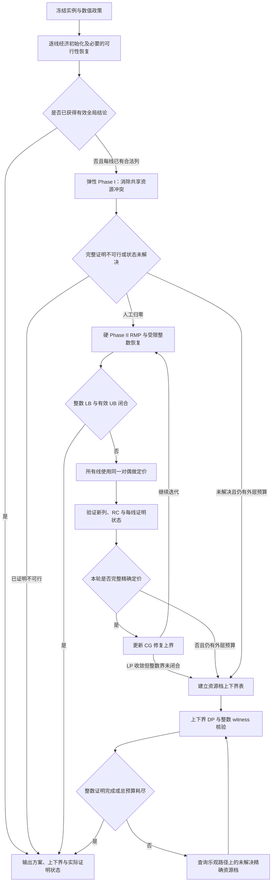

# 整线列生成与整数资源协调：算法设计详解

> 阅读对象：希望理解实现、向导师讲解方法、准备论文或后续改进算法的研究者。
>
> 版本范围：当前论文使用的 `sub/stage9/balanced_bound.py` 及其实际调用链；源码阅读基线 `7aa6cec7`。原问题定义以 `code/milp/model.py` 为准。代码索引和已有证书摘录见本目录 JSON 文件。本次没有新增优化实验。

## 1. 先用一句话说明我们在做什么

**先为每条拆卸线寻找内部完全合法的方案，再协调这些方案对共享人工和机器人的需求；用列生成改进线性松弛，用整数恢复寻找真实方案，用资源档搜索和有效上界完成整数最优性证明。**

当前方法包含四个紧密配合的部分：

1. **整线建模**：把一条线的任务选择、站点、模式、优先关系、节拍、疲劳和回收要求封装到一个局部整数模型里。
2. **列生成**：主问题只保留少量完整线方案；根据资源的对偶价格，逐线寻找值得加入的新方案。
3. **整数方案恢复**：从已经生成的完整线方案中，每线真正选一个，检查共享资源后得到整数可行解。
4. **按需资源档搜索**：必要时直接搜索某条线在指定人工、机器人数下的最好方案，通过二维动态规划组合并收紧整数上下界。

所以，我们论文中的实现应完整称作“整线列生成与整数资源协调框架”。直接把所有整数最优性都归因于 CG 本身，会遗漏后两部分的作用。

当前实验没有执行旧版 `code/dwcg/branch_price.py` 的全局分支树，也没有执行 RL 策略。CPLEX 仍负责局部 MILP、主问题 LP 和受限整数主问题的求解。研究设计的贡献在于如何分块、如何交换信息、如何组合整数解及如何形成证明。

先用下面的概览建立整体印象；其中“有效界闭合”始终要求存在已核验整数方案。详细状态和例外处理在后续章节展开。



图中省略了错误处理及最终零价格经济界整理；完整的代码级顺序见第 19 节。资源档搜索也可能以已有信息直接闭合而不发起查询。

## 2. 算法究竟面对什么问题

### 2.1 数据和决策

设拆卸线集合为 $\mathcal L$。线 $l$ 的任务集合为 $\mathcal I_l$，候选工作站为 $\mathcal S_l=\{1,\ldots,K_l\}$，任务 $i$ 可用的模式为 $\mathcal M_{li}\subseteq\{H,R,J\}$。

- H：人工执行。
- R：机器人执行。
- J：人工与机器人协作执行。

不是每个任务都能任选三种模式；只允许使用输入中实际给出的模式。J 的处理时间直接使用 J 模式参数，不把 H 和 R 的时间相加。

主要变量为：

| 变量 | 含义 |
|---|---|
| $y_{li}\in\{0,1\}$ | 任务是否执行 |
| $x_{lism}\in\{0,1\}$ | 任务是否分配到站 $s$ 并采用模式 $m$ |
| $u_{ls}\in\{0,1\}$ | 站点是否启用 |
| $h_{ls}\in\{0,1\}$ | 站点是否配置人工 |
| $r_{ls}\in\{0,1\}$ | 站点是否配置机器人 |

**任务所属的拆卸线由输入确定。** 当前模型不会把 L1 的任务重新分配给 L2。求解器决定的是该线内哪些任务执行、在哪个站执行、采用哪种模式。

### 2.2 净利润如何计算

记任务回收收益为 $v_{li}$，模式直接执行成本为 $d_{lim}$；站点固定成本、人工配置成本和机器人配置成本分别为 $f_{ls},g^H_{ls},g^R_{ls}$。这里为了讲解将直接成本写为 $d$，避免与后文整列利润 $c_{lp}$ 混淆。

$$
\max Z=\sum_{l,i}v_{li}y_{li}
-\sum_{l,i,s,m}d_{lim}x_{lism}
-\sum_{l,s}(f_{ls}u_{ls}+g^H_{ls}h_{ls}+g^R_{ls}r_{ls}).
$$

收益由执行任务产生；执行成本按任务模式扣除；站点和资源配置成本按站扣除。一个站执行三个 H 任务，只配置一份人工，不计成三名工人。一个站包含 J 任务时，两类资源都需要配置。

### 2.3 约束分成“线内”和“跨线”两层

**任务唯一分配：**

$$\sum_{s,m\in\mathcal M_{li}}x_{lism}=y_{li}.$$

任务不执行时所有对应 $x$ 为零；执行时恰好选择一个站、一个模式。必做任务还满足 $y_{li}=1$。

**AND 前驱关系：** 对每条前驱弧 $(i,j)$ 和每个站点前缀 $k$，

$$
\sum_{s\leq k,m}x_{ljsm}\leq\sum_{s\leq k,m}x_{lism}.
$$

如果选择后继 $j$，必须选择所有要求的前驱，且每个前驱所在站不能晚于后继。同站执行允许存在。模型没有显式开始时间；同站任务可以在求解后按前驱拓扑关系排序。

**节拍：**

$$\sum_{i,m}t_{lim}x_{lism}\leq C_lu_{ls}.$$

这里是站内总工作量约束，不是优化整个产品的 makespan。不同工作站的节拍内时间不能直接理解为同一件产品的全局时钟。

**站点及资源双向配置逻辑：** 设 $N_l=|\mathcal I_l|$，

$$u_{ls}\leq\sum_{i,m}x_{lism}\leq N_lu_{ls},$$
$$h_{ls}\leq\sum_{i,m\in\{H,J\}}x_{lism}\leq N_lh_{ls},$$
$$r_{ls}\leq\sum_{i,m\in\{R,J\}}x_{lism}\leq N_lr_{ls}.$$

各式求和只包括可用模式。其意义是：有任务才启用；有人参与的任务才配人工；有机器人参与的任务才配机器人。配置由 assignments 唯一决定，不能通过无任务的“额外配置”改变资源档。空站合法，也没有要求已启用站点连续排列。

**疲劳：**

$$\sum_{i,m}\beta_{lim}t_{lim}x_{lism}\leq B_lh_{ls},\qquad B_l=-\ln(1-F_l^{\max}).$$

实际代码累加所有模式的 $\beta t$ 项，数据约定机器人模式不产生人工疲劳。约束针对一个工作站的任务累计负荷；没有建模工人跨站移动后的动态疲劳，也没有随时间恢复的状态转移。

**最低回收：**

$$\sum_i w_{li}y_{li}\geq W_l^{\min}.$$

以上全部属于单线约束。当前两类跨线约束为：

$$\sum_{l,s}h_{ls}\leq H^{\max},\qquad\sum_{l,s}r_{ls}\leq R^{\max}.$$

这里的“共享”是多条线竞争一个有限的配置资源池。模型没有描述同一个人在两个站之间按分钟轮流工作的时序调度。环形图是物理布局示意，数学上仍按 S1、S2、… 的有序站点处理，不含循环回流或跨周期路径选择。

## 3. 为什么从工作站列改成整线列

### 3.1 早期工作站列的困难

如果一列只代表一个工作站的方案，它只保证该站本地合法。把多个站的列拼起来，仍可能出现任务重复、必做任务遗漏、前驱关系不满足、回收不足或共享资源冲突。

例如，S1 的一列含任务 T1，S2 的另一列也含 T1；两列各自在自己的站内都合法，但不能同时使用。即使 LP 能用若干列的分数组合满足约束，现有列池也未必允许每站各选一列组成整数解。

### 3.2 整线列把大量兼容性问题提前解决

新列包含一整条线的完整整数方案。生成时已经保证：

- 该线任务执行不重复，必做任务齐全；
- 模式可用，AND 前驱和站点顺序成立；
- 每个站的时间、疲劳及资源配置逻辑成立；
- 整条线最低回收要求满足。

任务集合按线划分、优先弧只在线内，因此不同线方案组合后，这些条件不会彼此破坏。组合时只需检查人工总量和机器人总量。

这直接降低了“多个局部合法列拼不成整数解”的复杂程度。不过，资源冲突仍可能使受限列池整数不可行；整线列并没有消除所有整数困难。

### 3.3 代价是什么

局部 PP 从“一个站”扩大为“一条线的所有任务和站点”，单次定价更难。我们的选择是在主问题兼容性与局部求解难度之间做平衡。

总任务数相同，分成更多、较小的线，可能降低每个 PP 的难度；但线数增加也意味着更多 PP 和更复杂的资源协调。仅凭总任务数或线数无法保证加速。

## 4. 一列究竟保存什么

线 $l$ 的全部整数可行方案构成集合 $\mathcal P_l$。一列 $p\in\mathcal P_l$ 包括所有站的 assignments 和配置，由此汇总三个主问题系数：

$$
h_{lp}=\sum_sh^p_{ls},\quad r_{lp}=\sum_sr^p_{ls},\quad
c_{lp}=\text{该线收益}-\text{执行成本}-\text{所有站点及资源配置成本}.
$$

实现中的列结构为：

```text
line       线 ID
profit     整线净利润
human      整线配置人工数
robot      整线配置机器人数量
stations   各站记录：station、assignments、active、human、robot、
           duration、fatigue、recovery、profit
```

主问题的矩阵只需要 $(c_{lp},h_{lp},r_{lp})$，但证据中必须保留完整站点方案，否则无法恢复和验证原问题解。

局部建模用 `local_data(line)` 把人工和机器人上限均设为 $K_l$。由于每站每类配置至多为 1，这两个界是冗余界，允许该线探索全部本地方案。它们不是提前分给该线的全局资源配额。

`validate_column()` 将该线方案同时交给数据级检查和原 Compact 约束检查。`column_key()` 按每站完整任务—模式 assignments 去重；正式求解路径会先排序 assignments，不能只按选中任务集合或利润去重。

## 5. 完整主问题及其与原问题的关系

### 5.1 完整列整数主问题

$$
\begin{aligned}
\max\quad &\sum_l\sum_{p\in\mathcal P_l}c_{lp}\lambda_{lp}\\
\text{s.t.}\quad&\sum_{p\in\mathcal P_l}\lambda_{lp}=1&&\forall l,\\
&\sum_{l,p}h_{lp}\lambda_{lp}\leq H^{\max},\\
&\sum_{l,p}r_{lp}\lambda_{lp}\leq R^{\max},\\
&\lambda_{lp}\in\{0,1\}.
\end{aligned}
$$

每条线恰好选一个完整方案。“恰选一个”不等于每条线必须执行所有任务；任务选择已经发生在列内部。只有当必做和回收要求允许时，整条线全空的方案才存在。

### 5.2 为什么与原 Compact-IP 等价

从原问题的整数可行解出发，按线拆分，其每个线内方案都属于 $\mathcal P_l$。选中这些列，资源总量和利润不变。

反过来，每线选一个合法整线列，将其 $x,y,u,h,r$ 写回原模型。每线局部约束由列保证，两类全局约束由主问题保证，任务没有跨线重复定义，目标按线相加。因此得到同利润的原问题整数可行解。

所以，完整列整数模型与原模型在最优值和可行性上等价。

### 5.3 必须区分四种目标值

| 模型 | 使用的列或变量 | 主要用途 |
|---|---|---|
| Compact-IP | 原始二元变量 | 原始整数最优值 |
| Compact-LP | 放松原二元变量 | 一种 LP 上界 |
| Full-line-IP | 所有整线列，整数选列 | 与 Compact-IP 等价 |
| Full-line-LP | 所有整线列，允许分数 | CG 所逼近的完整 LP |

对于最大化问题，完整模型之间有：

$$Z^{IP}=Z_{\text{full-line}}^{IP}\leq Z_{\text{full-line}}^{LP}\leq Z_{\text{compact}}^{LP}.$$

与原工作站分块使用相同模型时，还有：

$$Z_{\text{full-line}}^{LP}\leq Z_{\text{full-station}}^{LP}\leq Z_{\text{compact}}^{LP}.$$

原因是整线整数集合的凸组合自动满足更多线内组合关系。每个整线凸组合也能投影为工作站凸组合，后者又能投影为原变量的分数可行解；反方向一般不成立。

但这些关系不能直接套在任意受限列池上。**RMP-LP 的值是完整线 LP 的下界，却不一定是原问题整数最优值的上界或下界。** 它可能因为缺列低于整数最优值，也可能因为分数混合高于整数最优值。

## 6. 为什么不一次生成所有列

一条线每个任务可能不选，或者被分配到若干站和模式，组合规模会迅速增长。完整列模型适合理论定义和极小例 Oracle，不适合普通实例直接枚举。

列生成维护子集 $\overline{\mathcal P}_l\subseteq\mathcal P_l$。一次迭代只问：在当前主问题价格下，是否存在一个比已有列更有价值的完整线方案？这个问题由单线 MILP 回答。

实际主问题只有 $L$ 条凸性等式和两条共享资源不等式；变量数量随生成列增加。列生成不会按固定顺序枚举所有分配，也不需要最后得到所有列。

## 7. 从 RMP 对偶理解定价

### 7.1 Phase II 对偶

把主问题的 $\lambda$ 放松为非负连续变量。记凸性等式的对偶为 $\sigma_l\in\mathbb R$，人工和机器人不等式的对偶为 $\pi_H,\pi_R\geq0$。完整对偶为：

$$
\begin{aligned}
\min\quad&D=\sum_l\sigma_l+H^{\max}\pi_H+R^{\max}\pi_R\\
\text{s.t.}\quad&\sigma_l+\pi_Hh_{lp}+\pi_Rr_{lp}\geq c_{lp},\quad\forall l,p.
\end{aligned}
$$

RMP 只检查已有列的这些不等式。新列可能违反当前对偶约束，因此要通过定价寻找。

### 7.2 Reduced cost 的来源

列的检验数为：

$$\bar c_{lp}=c_{lp}-\pi_Hh_{lp}-\pi_Rr_{lp}-\sigma_l.$$

可以把它理解为“该线方案的净利润，减去资源稀缺性对应的价格，再减去本线凸性价格”。$\pi_H,\pi_R$ 是算法中的影子价格，原来的人工、机器人经济成本已经包含在 $c_{lp}$ 里；两者作用不同。

资源紧张时，价格可能提高，使 PP 愿意牺牲一点线内利润换取较少的资源使用。资源不紧张时，某类价格可能为零。退化时价格可以不唯一，因此不能把每次价格变化都解释成独立的物理规律。

**教学计算，非实验：** 某列利润 100，使用人工 2、机器人 1，当前 $\pi_H=8,\pi_R=3,\sigma_l=75$，则 $\bar c=100-16-3-75=6>0$。该列违反当前 RMP 对偶约束，可以扩充列池；不意味着加入后系统利润恰好增加 6。

### 7.3 定价子问题

对每条线求：

$$\rho_l=\max_{p\in\mathcal P_l}\{c_{lp}-\pi_Hh_{lp}-\pi_Rr_{lp}-\sigma_l\}.$$

实际建立的是原单线整数模型，只更新目标。Phase II 目标写成原变量形式：

$$
\sum_i v_{li}y_{li}-\sum_{i,s,m}d_{lim}x_{lism}
-\sum_s\left[f_{ls}u_{ls}+(g^H_{ls}+\pi_H)h_{ls}+(g^R_{ls}+\pi_R)r_{ls}\right]-\sigma_l.
$$

$-\sigma_l$ 不改变同一条线内部哪个方案最好，但计算检验数和上界时必须保留。

当前整线主问题没有任务覆盖、前驱或回收行，所以没有这些约束的主问题对偶价格。它们属于 PP 的可行域。不要把旧工作站分块的检验数公式直接搬到这里。

### 7.4 一轮怎样执行

1. 求解当前 RMP-LP，确认其最优状态并检查原始可行性。
2. 读取 $\sigma,\pi_H,\pi_R$，检查符号、原始/对偶目标一致及已有列对偶可行性。
3. 固定本轮价格，依次求解所有线的 PP。
4. 根据 PP 返回的真实 assignments 重新计算利润、资源和检验数。
5. 合法且 $\bar c>\varepsilon_{rc}$ 的新列加入列池。
6. 本轮所有 PP 结束后，才根据完整证明状态更新 CG 上界或决定停止。

同一轮所有线使用同一套 RMP 对偶。前一条线的新列不会在本轮中途触发一次新 RMP、再给后一条线使用另一套价格。

## 8. 初始化：先让每条线有一个合法方案

### 8.1 短经济求解

正式配置首先给每条线约 0.5 s，求解没有资源影子价格的单线利润最大化问题。实际限时还受全局剩余时间和线数分摊约束。

这里有三个有区别的结果：

- 找到合法方案：可以作为初始列，哪怕还未证明该线经济最优。
- 可靠证明局部无解：整条线不存在合法方案，原问题也无解。
- 超时且没有方案：只能说初始化未解决，不能判原问题无解。

第三种情况会尝试常数目标的局部可行性恢复，正式配置最多再给约 0.5 s。它只找合法线方案，不能把其常数目标 Best Bound 当利润上界。

### 8.2 为什么初始独立方案就可能证明最优

设每条线原经济目标都有有效上界 $b_l^e$，则：

$$UB_e=\sum_lb_l^e$$

是全局整数问题和完整整线 LP 的上界。因为忽略跨线资源耦合只会扩大可行域，每条线都不可能超过自己的经济最优值。

如果初始各线方案的总资源已经满足共享上限，其组合就是原问题整数可行解。若其利润与 $UB_e$ 闭合，可以直接结束。没有必要为了“使用 CG”再强行迭代。

甘特图的 20 任务实例正是这种路径，详见第 14 节。

### 8.3 独立方案资源冲突并不表示问题无解

每条线独立追求利润可能都选较多人工或机器人。只要存在其他资源节约方案，就可能协调成功。这时进入 Phase I。

## 9. Phase I：先消除资源冲突

### 9.1 弹性 RMP

每条线已有至少一个合法方案后，保持凸性约束为硬约束，增加两个非负人工变量 $a_H,a_R$：

$$
\begin{aligned}
\max\quad&-a_H-a_R\\
\text{s.t.}\quad&\sum_p\lambda_{lp}=1,&&\forall l,\\
&\sum_{l,p}h_{lp}\lambda_{lp}-a_H\leq H^{\max},\\
&\sum_{l,p}r_{lp}\lambda_{lp}-a_R\leq R^{\max},\\
&\lambda,a_H,a_R\geq0.
\end{aligned}
$$

例如，共享人工上限 7、机器人上限 6，初始组合使用 8 人和 8 台机器人，取 $a_H=1,a_R=2$ 就能满足弹性模型，Phase I 目标为 $-3$。

人工变量是暂时容纳资源超额的数学变量，不是实际增聘的工人或借来的机器人。它们必须在进入真实可行阶段前归零。

因为任务、前驱和回收已经全部在线内列中得到满足，当前整线主问题只需弹性化这两条资源行。旧工作站 B&P 的广义弹性 Phase I 涉及更多行；不能混为同一个实现。

### 9.2 Phase I 定价不是追求利润

真实列的经济利润系数全为零，定价为：

$$\rho_l^I=\max_{p\in\mathcal P_l}\{-\pi_Hh_{lp}-\pi_Rr_{lp}-\sigma_l\}.$$

由于人工变量的目标系数为 $-1$，其对偶约束给出 $0\leq\pi_H,\pi_R\leq1$。这时 PP 更倾向于找到减少当前资源冲突的方案，而不是最大利润方案。

### 9.3 为什么人工量归零说明 LP 可行

完整 Phase I 的目标不超过零。如果完整真实 LP 可行，可令人工变量为零，Phase I 最优值就是零。反过来，如果人工量为零，剩余 $\lambda$ 已满足真实资源和凸性约束，构成完整线 LP 的可行解。

这说明的是 **LP 可行**，因为 $\lambda$ 可能是分数。它没有证明存在每线真正选一个方案的整数组合。

代码发现人工总量小于等于容差时，记录 `phase_transition=True`，下一次循环重新建立无人工变量的 Phase II RMP。没有继续使用 Phase I 的利润系数或旧对偶。

### 9.4 Phase I 怎样证明不可行

必须取得完整精确定价，再形成完整 Phase I 的有效上界。如果该上界严格小于负的人工容差，则完整 Phase I 达不到零，真实完整 LP 不可行，原整数模型也不可行。

仅仅当前 RMP 的人工量大于零，不能证明不可行；可能只是还缺少节约资源的列。PP 超时、异常或零改进列的启发式结果，也不能替代完整证明。

## 10. Phase II 与完整 LP 上界

### 10.1 恢复利润目标

Phase II 使用整列真实净利润，没有人工变量。主问题在已知线方案之间协调资源；每次定价提供更多利润与资源使用的折中方案。

### 10.2 为什么需要“修复”上界

最优 RMP 对偶只覆盖已有列，不能直接作为完整 LP 的可行对偶。对每条线求出 $\rho_l$ 后，定义：

$$\sigma'_l=\sigma_l+\max(0,\rho_l).$$

由于任意合法列的检验数都不超过 $\rho_l$，有：

$$c_{lp}-\pi_Hh_{lp}-\pi_Rr_{lp}\leq\sigma_l+\rho_l\leq\sigma'_l.$$

所以 $(\sigma',\pi_H,\pi_R)$ 满足完整对偶全部约束。由弱对偶：

$$Z_{\text{full-line}}^{LP}\leq UB_{CG}=D_{RMP}+\sum_l\max(0,\rho_l).$$

数学精确条件下 $D_{RMP}=Z_{RMP}$。代码使用检查过的 `dual_objective`，并检查它与 RMP 原始目标的误差，避免把未经核验的原始目标直接放进证明。

### 10.3 何时才能标记完整定价

`complete_exact_pricing=True` 要求：

- 已覆盖每条线；
- 每条线 PP 都被求解器证明最优；
- 所有定价对应同一个当前 RMP 的阶段和对偶；
- 新列及检验数通过独立重算。

有 incumbent 但超时的最大化 PP，当前检验数只提供其最优检验数的下界。该数即使为负，也不能说明不存在正检验数列。

实现会继续尝试本轮其他线；任何线未证明最优，本轮都不能产生上述新的 CG 修复界，随后停止这个 CG 循环。合法正检验数 incumbent 可以保留为候选列，但不会把这轮标成精确定价成功。

### 10.4 LP 终止与整数终止

全部 PP 最优且每条线 $\rho_l\leq\varepsilon_{rc}$，可以报告指定容差下完整线 LP 收敛。残余界差最多按线数累积，即约 $L\varepsilon_{rc}$，还需考虑原始/对偶核验误差。

另一种更早结束的情况是：已经有真实整数解，其利润与现有有效上界闭合。此时无需等检验数全部归零，也可以证明整数最优。代码中的 `lp_optimal_proven` 可能仍为 false，后文真实 80 任务例子即如此。

### 10.5 Phase I 的界不能当利润界

Phase I 也用同样的对偶修复形式，但它界定的是“负人工总量”目标。例子中的 Phase I 修复界 7 只是一个较松的可行性阶段上界，不是系统利润上界。Phase II 才讨论经济利润。

## 11. 整数方案获取：从列池中真正选方案

### 11.1 受限整数主问题

将当前池内的 $\lambda$ 设为二元变量，每线选一个方案，在共享资源上限下最大化利润。这是一个规模通常较小的整数选择问题。

正式 CG 入口在 Phase II 的 RMP 求解后尝试整数恢复，每次默认最多约 0.5 s；精确定价收敛后还会再尝试。能得到经验证的 incumbent 就可以提高 LB，不要求这次受限主问题一定证明最优。

**受限整数最优只说明在现有列池中最好。** 要宣布原问题整数最优，还需要全局有效 UB 与其利润闭合。

### 11.2 为什么有时列池整数不可行

整线列已经解决了线内兼容性，但池内可能缺少某条线低人工、低机器人或某种折中资源档的方案。LP 可以通过凸组合凑出平均资源，整数组合却无法这么做。

这也是不能简单对分数 $\lambda$ 四舍五入的原因：即使每线只取最大权重列，资源总量仍可能超限。

### 11.3 每个整数候选必须检查什么

`verify_integer_assignments()` 先按数据重算全部站点，并填回原 Compact 模型的变量，再检查：

1. 每站记录完整且无重复，任务和模式合法；
2. 每个任务至多执行一次，必做任务齐全；
3. 所有 AND 前驱选择与站点顺序成立；
4. 节拍、疲劳、启用和 H/R 配置逻辑成立；
5. 每线最低回收满足；
6. 总人工、机器人不超过共享上限；
7. 数据重算利润与原 Compact 目标一致；
8. 原 Compact 的全部约束在核验容差下有效。

只有这样的实际方案才能提高全局整数 LB。RMP-LP 的目标、人工变量尚未归零的解、或者未经检查的整数近似值都不可以。

## 12. 按需资源档：为什么还能在 CG 后证明整数最优

### 12.1 定义精确资源档

对线 $l$ 和整数资源数 $(a,b)$，定义：

$$v_l(a,b)=\max\{c_{lp}:p\in\mathcal P_l,\ h_{lp}=a,\ r_{lp}=b\}.$$

这里必须是 **恰好** $a$ 个人工、$b$ 个机器人，不是“最多”。代码使用两条等式 `exact_h`、`exact_r`。档内无解时，数学上记为 $-\infty$。

全局可行整数解不会在某一条线使用超过全局总容量的资源，因此只需枚举档索引：

$$0\leq a\leq\min(K_l,H^{\max}),\quad0\leq b\leq\min(K_l,R^{\max}).$$

这只是生成一个有限的资源索引表，**不等于枚举所有整线列，也不等于一开始求解所有档**。

### 12.2 为什么同一个档只需保留最好方案

同一条线同一资源档的不同方案，对主问题的资源系数完全一样。把其中利润较低的方案替换为更高利润方案，不会改变任何跨线约束。

因此只要知道每个档的最大利润和一个达到该利润的合法方案，就能完成原整数问题的组合优化。这种压缩依赖当前“跨线只耦合两类配置总数”的结构。

将来若增加跨线任务关系、时段资源调度或其他耦合系数，两个方案即便人工和机器人数相同也未必等价，需要重新设计状态。不能无条件沿用当前二维 DP。

### 12.3 每个档同时维护下界与上界

| 档内信息 | 作用 |
|---|---|
| 已核验的实际列利润 $\underline v_l(a,b)$ | 该档的可行利润下界 |
| 有效的 $\overline v_l(a,b)$ | 该档最优利润上界 |
| `not_run` / `seeded` | 尚未求出档内最优；已有列也只保证下界 |
| `time_limit` | 保留 incumbent 和可靠 Best Bound，档仍未解决 |
| `optimal` | 档内最大利润已证明 |
| `infeasible` | 已证明该档没有合法方案 |

没有上界的信息在数学上表示 $+\infty$，在 JSON 中用 `null` 表示。没有候选列意味着暂时不能用该档构造 LB，不意味着该档不可行。

### 12.4 CG 给资源档留下了什么

第一，列池已有的列按资源数分组，每档取利润最大的一个作为初始候选。

第二，局部经济上界可作用于所有档：$v_l(a,b)\leq b_l^e$。

第三，任意一轮完整 Phase II 定价提供：

$$v_l(a,b)\leq\sigma_l+\max(0,\rho_l)+\pi_Ha+\pi_Rb.$$

证明来自该轮修复后的对偶不等式。把右侧看作资源数 $(a,b)$ 上的一张利润“天花板”，它覆盖该线所有合法方案。

实现对经济界和多轮这种界取最小值，形成每个档的初始 UB。因此 CG 的价值不仅是生成几个好方案，还能为尚未查询的资源档提供上界信息。

### 12.5 两套二维动态规划

可以用容量式递推解释：

$$F_l(A,B)=\max_{a\leq A,b\leq B}\{F_{l-1}(A-a,B-b)+v_l(a,b)\},\quad F_0(A,B)=0.$$

生产代码采用等价的“精确已用资源”稀疏状态：

```text
states[(0,0)] = (profit=0, empty_path)
逐条处理线：
    对每个已有资源状态和当前线的候选档：
        累加人工、机器人和利润
        超出全局容量则忽略
        同一资源总量只保留最高利润及对应路径
最后在全部不超容量的状态中取最高利润
```

**下界 DP** 只使用有真实候选列的档，用该列真实利润作系数。选中路径后再次验证原问题方案，得到全局 LB。

**上界 DP** 保留所有未被证明不可行的档，用档内 UB 作系数。即使某个档还没有实际方案，也不能删除；未知 UB 按 $+\infty$ 处理。这给出对所有可能整数资源组合的乐观上界。

上界路径是“最值得继续查证的可能组合”，不是已经存在的真实拆卸方案。有限容量状态都消失、且未知档也被安全保留后，上界 DP 无路径才证明整数不可行。

### 12.6 按需查询什么档

代码每次先重新计算上下界 DP，再做以下选择：

1. 取当前上界 DP 的最大值路径。
2. 找路径中还未标为 `optimal` 或 `infeasible` 的档。
3. 选择尝试次数最少的档；并列按线 ID、档索引确定性排序。
4. 对该线建立新的原经济 MILP，加精确人工和机器人数量等式。
5. 记录实际 incumbent、Best Bound、最优或不可行证明。
6. 更新该档，再次计算上下界 DP。

它不是把全局求解预算平均发给所有档，也不是一定先查局部 gap 最大的档；实际策略是“当前最乐观组合上，优先查较少尝试的未知档”。

### 12.7 查询预算怎样增长

首次默认最多 2 s，之后按尝试次数几何增长：

$$T_{query}=\min\{2\cdot2^{\min(\text{attempts},8)},\ T_{remaining}\}.$$

因此单档最多增长到基础预算的 256 倍，再受总剩余时间限制。超时不删除该档，下次可能继续查；当前实现重建该档 MILP，没有保存并继续上一次 CPLEX 搜索树。

### 12.8 为什么整数 DP 界可能比完整线 LP 还紧

完整线 LP 允许一条线在不同资源档之间取凸组合，二维整数 DP 每条线只能选一个整数档。因此 DP 上界在档界足够紧时可以低于完整线 LP 最优值。这不是矛盾：DP 界约束整数问题，未必约束分数 LP。

**教学例子，非真实任务数据：** 两条线各有两种资源档，机器人使用量均为 0：

| 每条线的方案 | 人工数 | 利润 |
|---|---:|---:|
| A | 1 | 4 |
| B | 3 | 9 |

全局人工上限为 3。整数情况下只能两条线都选 A，总利润 8；任何一条线选 B，另一条线至少需要 1 人，总量就达到 4。

LP 可以让第一条线取一半 A 和一半 B，第二条线选 A，人工总量为 $2+1=3$，利润为 $6.5+4=10.5$。这是合法 LP 解，却不对应真实整数分配。

完整档值已知时，上界 DP 和下界 DP 都给出 8，从而证明整数最优；完整 LP 仍为 10.5。这个例子说明：CG 收敛不等于整数最优，而整数最优证明也不必依赖 LP gap 为零。

## 13. 最终如何形成最优性证明

### 13.1 LB 的来源

LB 只来自原问题已核验的实际整数方案：独立线方案组合、受限整数主问题解或资源档下界 DP 组合。

### 13.2 UB 的来源

| 上界 | 限定对象 | 取得条件 |
|---|---|---|
| 独立单线经济界之和 | 完整线 LP 和原 IP | 每线都有可靠经济上界 |
| 完整精确定价修复界 | 完整线 LP 和原 IP | 同一对偶下全部线 PP 已证最优 |
| 资源档上界 DP | 原 IP | 全部可能资源档保守保留，档界有效 |
| 零资源价格 PP 的经济界之和 | 完整线 LP 和原 IP | 无额外域限制、Phase II、可靠原生 Best Bound |

最终对可用的有效 UB 取最小值。最后一种在 `economic_bound.refine()` 做额外整理：当两类资源价格均为零时，PP 的目标为 $c_{lp}-\sigma_l$，因此其原生上界加回 $\sigma_l$ 后才是经济利润上界。还要排除带额外配额限制的定价域。

这是受限的可靠 Best Bound 利用方式，不是对任意截断定价都直接拿 incumbent 修复新一轮 CG。资源档 PP 的 Best Bound 则只界定同一个精确资源档，不能直接冒充整条线全域经济上界。

### 13.3 闭合条件

$$gap_{abs}=UB-LB,$$
$$gap_{rel}=\frac{\max(0,UB-LB)}{\max(1,|LB|)}.$$

最优证明的数值条件为：

$$UB-LB\leq\max\{\varepsilon_{abs},\varepsilon_{rel}\max(1,|LB|)\}.$$

前提是 LB 的方案、UB 的来源及所有依赖证书都有效。没有 LB 或没有有效有限 UB，gap 为未知。UB 若明显低于 LB，触发数值一致性错误，不能通过把 gap 截成零掩盖矛盾。

全局不可行可能来自：某条线整数域为空、完整 Phase I 证明 LP 不可行，或资源档上界 DP 证明不存在任何整数资源组合。

### 13.4 为什么这里能不建全局 B&P 树

每条线全部复杂内部决定已经包含在局部模型；跨线只有少量整数资源总数。有限的二维档表足以完整表达整数协调。当上界路径上的不确定档被逐步解决后，可以通过 DP 证明整个组合问题的最优或不可行。

在没有时间限制、每个局部问题最终被正确解决、数值状态可靠的理想条件下，有限档集合提供完整求解途径。现实限时运行不保证解决所有关键档，必须保留剩余 gap。

CPLEX 在局部 MILP 内部仍可能执行分支定界。这里没有的是我们算法外层自己维护的跨线 B&P 搜索树，不能说“整个算法完全没有分支搜索”。

## 14. 三个来自真实证书的完整例子

以下数值从现有文件读取，来源哈希已经核对。`evidence_summary.json` 保留未经手工四舍五入的数值和每轮对偶。下表只是便于阅读的显示值。

### 14.1 甘特图小例：初始化就闭合

来源：`essay/add/gantt_demo_n20_L2/cg_result.json`，20 个任务、2 条线、每线 4 个候选站。

- 分解解选中 14 个任务，使用 3 个人工、2 个机器人。
- 最终 LB 和 UB 都为 132.58。
- CG `history` 长度为 0；记录了 2 次单线初始化定价调用。
- 终止原因为 `independent_line_optima_are_resource_compatible`。

这说明：两条线独立找到的方案已经能在共享容量下组合，且其利润闭合了有效上界。它适合展示任务分配，但不是展示多轮 CG 迭代的例子。论文中的甘特图站内时间是后处理拓扑排序恢复的展示，不是另一次调度优化。

### 14.2 80 任务四线例：通过完整 CG 界和整数恢复闭合

实例：`tasks080_lines04_conflict_candidate_seed32`。源证书位于 `sub/stage12/evidence/formal600/` 对应 `balanced_bound` 子目录。

| history 编号 | 阶段 | RMP 目标 | 当轮情况 | 修复界 | 新列数 |
|---:|---|---:|---|---:|---:|
| 1 | I | -3.0000 | 人工超额 1、机器人超额 2；完整定价 | 7.0000（Phase I 目标界） | 4 |
| 2 | I | 0.0000 | 人工量归零，切换阶段，无 PP | — | 0 |
| 3 | II | 414.3500 | 完整定价 | 787.8900 | 4 |
| 4 | II | 500.6300 | 完整定价 | 602.7733 | 4 |
| 5 | II | 578.6800 | 完整定价 | 583.6400 | 2 |
| 6 | II | 583.6400 | 整数恢复后与已有上界闭合，无 PP | — | 0 |

第 5 条记录中，各线最大检验数约为 $0,4.755,0,0.205$，所以修复界为 $578.68+4.755+0.205=583.64$。

第 6 条记录求解扩充后的 RMP，并恢复到利润 583.64 的整数方案。上一轮已有 UB 583.64，因此直接证明整数最优，无需再执行第 6 轮定价。

最终池中 18 列，PP 调用 20 次：4 次初始化，加上 4 轮每轮 4 次定价（1 轮 Phase I、3 轮 Phase II）。资源档查询为 0。测得端到端时间约 19.36 s，数值来自历史记录，不是本次重新运行。

代码中 `lp_optimal_proven=False`，因为没有走“所有检验数足够小”的标记分支；整数证明仍然有效。实际上这里最后 RMP 值与有效完整 LP 界也闭合，但解释保存字段时不能把未设置的标志写成 true。

同输入 Compact 在约 595.68 s 的实际协议运行中也得到利润 583.64，但 UB 仍约 618.2649，未完成整数最优证明。这个例子体现的是证明完成时间优势，不能据此声称 Compact 没找到同质量方案。

### 14.3 120 任务六线例：CG 未收敛，资源档证明整数最优

实例：`tasks120_lines06_ratio80_seed34`。源证书位于 `sub/stage13/evidence/robust180/` 对应 `balanced_bound` 子目录。

CG 开始时 Phase I 人工量为 $(2,3)$，通过补列归零。Phase II 的 RMP 目标依次出现约 807.60、976.82、980.74。

最后一次 CG 定价不是所有线都完成最优证明，因此不能为这一轮形成新的修复 UB。CG 部分记录：

- `status=time_limit`；
- `termination_reason=pricing_not_proven_optimal`；
- 整数 LB 约 977.02；
- 已有有效 UB 约 1101.4566；
- `lp_optimal_proven=False`。

外层保留了已有列和界，转入资源档阶段。经过 **31 次档查询**，最终得到 LB 1009.98、UB 1009.98，报告整数最优。

其含义是：资源档整数协调消除了对原整数目标的不确定性。它没有把未完成的 CG 定价改成成功，也没有证明此前完整线 LP 已收敛。

这三个例子分别说明：初始化可能直接成功；CG 界可能与整数恢复配合成功；CG 不完整时，另一个独立有效的整数证明路径仍可能成功。

## 15. 当前软件调用链

```text
sub/stage11/run_plan_v2.py        冻结输入、父进程预算、运行和离线审计
  └─ sub/stage11/worker_v2.py     导入方法、参数、进度记录、证据持久化
      └─ sub/stage9/balanced_bound.py::run
          ├─ demand_balanced.py::run
          │   ├─ cg_balanced.py::run
          │   │   ├─ line_cg.py::solve_master
          │   │   ├─ persistent_line.py::LinePricing.solve  [CPLEX warm]
          │   │   └─ line_cg.py::solve_line                [重建路径]
          │   ├─ bound_sources / initial_table
          │   ├─ resource_dp.py::dynamic_program          [下界和上界]
          │   └─ profile_pp.py::solve_line                [精确资源档]
          └─ economic_bound.py::refine
```

关键入口索引（行号以 `SOURCE_INDEX.json` 中冻结的源码为准）：

| 文件与函数 | 应重点阅读的内容 |
|---|---|
| `sub/line_cg.py::local_data` | 局部容量为何冗余 |
| `sub/line_cg.py::validate_column` | 列合法性与原模型核验 |
| `sub/line_cg.py::build_master` | L 条凸性、2 条资源行、人工变量及利润 |
| `sub/line_cg.py::solve_master` | 原始/对偶一致性、整数恢复 |
| `sub/stage9/cg_balanced.py::run` | 实际 CG 主循环、阶段切换、完整定价门槛 |
| `sub/stage3/persistent_line.py::LinePricing` | CPLEX 持久化、完整目标更新、warm start |
| `sub/stage9/demand_balanced.py::bound_sources` | CG 对偶如何变为资源档上界 |
| 同文件 `initial_table` / `update` / `run` | 建档、查档、上下界 DP 和停止 |
| `sub/stage6/profile_pp.py::solve_line` | 精确资源等式下的经济 MILP |
| `sub/stage6/resource_dp.py::dynamic_program` | 稀疏资源状态及最优组合路径 |
| `sub/stage9/economic_bound.py::derive/refine` | 零价格经济界和最后界合并 |
| `code/dwcg/bp_solution.py::verify_integer_assignments` | 原问题整数 witness 检查 |
| `sub/stage9/verify_economic.py::audit` | 最外层离线证书核验 |

`sub/line_cg.py` 中也有一个历史 `run()`，但当前正式 worker 的 CG 主循环来自 `stage9/cg_balanced.py`。只阅读前者的 `run()` 会遗漏后续初始化、持久化定价和时间分配改进。

另一个容易误读的地方：`economic_bound.py` 自带历史 `run()`，其中引用 `stage8/demand_traced.py`；当前 `balanced_bound.py` 实际只导入其 `refine()`，基础求解来自 `stage9/demand_balanced.py`。文件中出现的 import 不一定处于当前主线执行路径。

## 16. 持久化定价与参数细节

### 16.1 复用什么

当前 CPLEX 路径每线创建一个独立的原生模型。后续 CG 定价复用其变量和约束，只更新目标、限时和起始解。不同线的 session 分开保存；同一 ID 若传入不同数据会被拒绝。

Phase I/II 切换时对**全部变量**更新系数，包括变为零的系数，避免利润或旧资源价格残留。原生 API 没直接包含在变量系数中的常数项在读取目标和 Best Bound 时加回，再独立重算检验数。

`pricing='warm'` 还把上次完整整数解作为 MIP start 提交，并要求求解器检查可行性。起始解只帮助搜索，不改变当前目标或可行域，也不构成最优证明。

### 16.2 没有复用什么

当前主线的 RMP 通过 `line_cg.solve_master()` 重建；没有把旧工作站 B&P 的增量 RMP 自动接进来。资源档 PP 也重建模型，不复用根 CG 的局部搜索状态。

持久化根 PP 明确不支持附加配额或分支限制，不能直接把某次资源档固定加进该会话、然后带着旧限制继续全域定价。

### 16.3 底层默认与正式实验配置不同

| 参数 | 底层默认或行为 | 当前正式 worker 使用 |
|---|---|---|
| CG 预算比例 `cg_fraction` | `demand_balanced.run` 默认 0.35 | 0.9 |
| CG 时间上限 `cg_cap_seconds` | 默认 6 s | 1,000,000 s，实际由比例和总限时约束 |
| 初始化 | `init_seconds` 可配置 | 每线经济 0.5 s，必要时常数目标 0.5 s |
| 根 PP | rebuild/reuse/warm | CPLEX 使用 warm |
| 受限 IP | 每次 0.5 s | 同默认 |
| history 上限 | 100 条记录 | 同默认，包含阶段切换等无 PP 记录 |
| 初次资源档查询 | 2 s | 同默认，后续几何增长 |
| 配额修复 `quota` | 有可选实现 | false |
| 线程 / 随机种子 | 后端配置 | 1 / 11 |
| 请求 MIP gap | 零相对、绝对 gap 设置 | 仍采用求解器浮点数值合同 |

因此直接运行底层文件的默认参数，不等于复现论文正式配置。当前主线也没有启用早期“删任务或配额补列”的修复分支；按需精确资源档承担了额外寻找兼容整数方案的主要作用。

### 16.4 时间分摊

一轮 CG 内，每个尚未求解的线 PP 获得“当前剩余 CG 时间 / 剩余线数”的预算。它是按剩余时间平分的顺序策略，不是并行求解，也不是学习策略。

CG 占用的是内部求解预算的一定比例；提前完成会把更多时间留给资源档。worker 预留 5 s 做证据持久化，最外层 `balanced_bound` 还为经济界整理预留约 0.25 s。建模、核验、系统调度均占时间，不能把每个参数简单当成独立可相加的实际耗时。

## 17. 数值、状态与证书怎样阅读

### 17.1 默认数值政策

| 参数 | 值 | 职责 |
|---|---:|---|
| LP primal / dual | $10^{-8}$ / $10^{-8}$ | 主问题和局部 LP 数值精度 |
| pricing integrality | $10^{-7}$ | PP 的任务分配整数检查 |
| branch integrality | $10^{-7}$ | 共用政策名称；当前也用于受限 IP 的选列整数检查 |
| column local | $10^{-8}$ | 列局部时间、疲劳等核验 |
| reduced cost | $10^{-7}$ | 改进列与精确定价收敛判断 |
| artificial | $10^{-7}$ | Phase I 人工量归零及负上界判断 |
| primal validation | $10^{-6}$ | 原始可行性检查 |
| bound consistency | $10^{-5}$ | 原始/对偶、利润和上下界一致性 |
| global absolute | $10^{-5}$ | 整数绝对 gap 闭合 |
| global relative | $10^{-8}$ | 整数相对 gap 闭合 |

这些阈值有不同职责；“零请求 MIP gap”不等于严格有理算术证明。结果的 `proof_scope` 是 `solver_floating_point_tolerances`。

### 17.2 结果有嵌套层级

```text
result                       balanced_bound 最终结果
  global_lower_bound / global_upper_bound / status / witness
  economic_evidence          最后整理的经济上界
  base_result                按需资源档阶段
    table / queries / lower_dp / upper_dp / bound_sources
    cg                       根 CG 阶段
      initialization / initialization_fallback
      history / integer_recovery / pool / timing / solver_events
```

看最终结论应看顶层 `status` 和全局证明标志，再沿着其界来源追溯。不能看到内层 `cg.status=time_limit` 就认为整个框架一定超时；也不能看到顶层整数最优就宣称所有 CG PP 都证明过最优。

常见根 CG 终止原因：

| 字段值 | 解释 |
|---|---|
| `independent_line_optima_are_resource_compatible` | 初始化方案组合与有效界闭合 |
| `verified_integer_and_valid_upper_bound_close` | 经验证整数解与有效 UB 闭合 |
| `exact_line_pricing_converged` | 完整精确定价达到 RC 容差 |
| `pricing_not_proven_optimal` | 本轮至少一个 PP 未证明最优 |
| `complete_line_Phase_I_upper_bound_negative` | 完整 Phase I 界证明 LP 不可行 |
| `CG_iteration_limit` | history 记录次数达到限制 |

没有定价记录不一定是“遗漏定价”。阶段切换和整数界提前闭合也会生成没有 PP 的 history 项。必须结合 `phase_transition` 和停止原因解释。

### 17.3 独立重放能做什么

`sub/validate.py` 独立枚举极小实例的任务省略、站点和模式，直接检查线内条件，建立完整列 LP/IP。后续验证链为：

```text
stage9/verify_economic.py
  → stage7/verify7.py
    → stage2/stage2_verify.py
      → sub/validate.py 中的独立算术与枚举工具
```

它们重算列利润、资源、RC、完整定价覆盖、资源档界和最终上下界。资源档验证器使用另外建立的整数主问题核对 DP 组合结果，而不是仅再次调用生产 DP。

极小实例可以完整枚举，直接核对局部最优值；较大实例无法这样认证全部局部空间，离线检查仍依赖求解器原生最优状态和有效 Best Bound 的合同。哈希只能证明文件一致性，不能替代数学有效性检查。

本目录 `collect_evidence.py` 只提取已有证据并检查哈希，不是上述独立最优性重放器，也不运行新实验。

## 18. 性能优势与瓶颈如何解释

### 18.1 可能获得优势的原因

1. 大 Compact 模型拆成较小的线模型，各线内部搜索与跨线资源协调分离。
2. 整线整数凸包可能强化 LP 界，减少松弛中的虚假组合。
3. 主问题只有两类资源耦合和每线凸性，求解通常很快。
4. 整数方案组合已不需要重新处理跨站的任务兼容性。
5. 持久化目标更新减少重复建模，并利用已有解帮助后续定价。
6. 资源档搜索只追踪可能影响当前最优上界的组合，不必解完所有档。

这些是结构上的机制解释，不等于已经完成了逐组件的因果消融。实际总加速还受 CPLEX 搜索过程、实例结构和初始化影响。

### 18.2 当前主要成本在哪里

论文归档主实验的原生定价耗时约占整个框架时间的 91%–99%，每次 RMP 的原生求解很短。因此几轮 CG 也可能耗时很长：迭代次数少不代表 PP 容易。

增加每线任务数会让单线 PP 更难；增加线数而保持每线较小，有时更有利。但更多线也增加定价次数和资源组合规模。当前实验存在两线、每线 40 任务的不利边界，应保留这一事实。

### 18.3 迭代次数应怎样报告

建议区分：初始化 PP 次数、Phase I 完整/截断定价轮数、Phase II 完整/截断轮数、总 PP 调用数、生成列数、受限整数恢复次数、资源档查询数和最终证明来源。

例如 80 任务例子的 history 有 6 条，实际只有 4 轮定价，不是 6 轮。Compact 分支节点数与 CG 轮数对应不同操作，不应直接用数值大小比较算法效率。

### 18.4 有限档 DP 的成本

每线最多有 $(\min(K_l,H^{\max})+1)(\min(K_l,R^{\max})+1)$ 个档。DP 的不同资源总量状态最多为 $(H^{\max}+1)(R^{\max}+1)$。

朴素状态转移成本约为每层“可达状态数 × 该线可用档数”；实际实现是稀疏字典并保存路径。资源数小的时候，这通常可控；若增加大量资源种类，状态空间会迅速膨胀。该方法不能自动推广成任意维度都便宜的精确组合器。

## 19. 一份贴近代码的完整伪代码

```text
输入：冻结实例、总预算、数值政策
输出：已验证整数方案、LB、有效 UB、实际证明状态

为每线创建独立局部模型会话
逐线做短经济求解，必要时做零目标可行性恢复
    得到合法列则入池
    已证明局部空域则记录全局不可行
    未解决则保留未知状态
记录所有可靠单线经济上界
若初始组合满足共享资源：验证并更新整数 LB
若 LB 与有效 UB 闭合：记录初始化闭合
否则：
    phase ← I
    在 CG 预算和记录数限制内循环：
        求 RMP，验证原始/对偶
        若 Phase I 人工归零：phase ← II，重新求硬 RMP
        若 Phase II：尝试受限整数恢复，核验并更新 LB
        若整数界闭合：结束 CG
        使用同一对偶逐线定价
            验证并保存合法正 RC 新列
            保存每线求解状态、incumbent 和 Best Bound
        若本轮非完整精确定价：停止 CG，保留已有列和有效界
        否则计算该阶段的修复上界
        若 Phase I 界严格负：记录 LP 不可行
        若 Phase II：更新利润 UB
        若所有 RC 不超过容差：记录相应 LP 结论并再尝试整数恢复
        若 LB 与 UB 闭合：结束 CG

从 CG 列池与完整定价记录构造资源档下界候选及上界
在剩余总预算内循环：
    下界 DP → 真实组合 → 原约束核验 → 更新 LB
    上界 DP → 乐观路径和 UB；与已有 CG 界取较小者
    若无任何可能整数路径：证明整数不可行，结束
    若有效 LB/UB 闭合：证明整数最优，结束
    若预算不足：保留已知结论，结束
    从乐观路径选最少尝试的未解决档
    求解精确资源档经济 MILP
    以真实列、可靠 Best Bound 或不可行证明更新该档

整理无额外域限制、零资源价格 PP 的经济上界
合并有效界，再检查整数闭合
写入完整证据和实际停止状态
父进程核对预算、文件哈希；独立进程重放证书
```

这份伪代码用于理解主要正常路径。代码还包含 solver error、数值不确定和限时异常等分支；错误状态不能当作不可行证明，正式报告需通过对应审计器核对证据。

## 20. 如何运行、如何向导师讲解

### 20.1 快速单例入口

在项目根目录运行下面命令可以调用当前正式算法配置。输出目录必须不存在：

```powershell
& experiments/.venv/Scripts/python.exe sub/stage11/run_plan_v2.py `
  --worker balanced_bound `
  --instance code/data/tasks020_lines02_each10_seed11.json `
  --budget 30 `
  --output sub/agDetail/runs/demo20_new
```

这直接调用 worker，适合理解流程；它没有启用外层 plan 的父进程 watchdog，也没有传入正式冻结源码清单。不能将这种单次演示自动当作论文公平计时实验。

正式对照使用计划入口，例如：

```powershell
& experiments/.venv/Scripts/python.exe sub/stage11/run_plan_v2.py `
  --plan sub/stage12/formal_plan.json `
  --output sub/stage12/evidence/new_formal_reproduction
```

该命令会启动计划中多个 600 s 预算运行，需要单独安排实验时间。本次文档工作没有执行它。计划中的 `status: NOT RUN` 是冻结计划生成时的状态；是否实际完成必须看对应运行目录的 accounting、summary 和重放结果。

### 20.2 预算和证据

正式 plan 会一次冻结输入，所有方法读取相同字节；记录源码和输入哈希，串行运行单线程求解器。父进程记录启动到退出的端到端时间，包括必要结果持久化。离线重放独立进行，其耗时不冒充算法求解时间。

内部时限、写盘预留与父进程 watchdog 在 Windows 下仍是受调度影响的控制机制。被强制终止的运行不能继承尚未完整持久化的最优证明；要检查 `timely`、`hard_stop`、返回码及证据哈希。

结果文件通常包括 `instance.json`、`result.json.zlib`、`summary.json`、`progress.jsonl` 和原生日志。进度事件只是观测记录，不一定都是更好的 incumbent；阅读最终 LB/UB 应以正式证据为准。

### 20.3 可以这样给导师概括

“我们先把每条拆卸线的任务选择、站点和模式决定做成完整整数方案。这样任务前驱、节拍、疲劳等兼容性在线内解决，主问题只协调人工和机器人两个共享总量。主问题给出资源影子价格，逐线 MILP 在这些价格下寻找新方案，形成列生成。我们同时从已有列恢复真实整数方案，并用完整定价修复对偶上界。如果 LP 和整数解仍有差距，就按精确人工—机器人数量建立资源档，优先查询当前乐观组合中的未知档，用上下界动态规划推进整数证明。最后只有真实整数利润与有效全局上界闭合，才宣称原问题整数最优。”

### 20.4 常见追问

**是不是把难约束删掉才变快？** 当前主线复用原 Compact 单线模型，线内约束仍存在，只是由 PP 承担；跨线两类资源仍由主问题和整数协调处理。

**是不是每条线单独求完就结束？** 只有独立方案资源兼容且有效界闭合时可以。资源紧张时需要 CG 和/或资源档协调。

**LP 选了半个方案，实际怎么执行？** 不能执行；LP 提供协调信息和界。真实方案来自整数恢复或下界 DP。

**为什么某个低利润列仍重要？** 它可能节省人工或机器人，使其他线执行高利润任务；全局利润可能因此提高。

**为什么不始终要求所有资源档都最优？** 证明全局最优只需排除比当前 LB 更好的组合。对不影响最终界的档，可以保留未解决状态。

**CG 已超时还能报告整数最优吗？** 可以，但必须由另一条完整有效证据链闭合，例如资源档 DP。不能把超时 PP 的 incumbent 伪装成精确定价结果。

**使用 CPLEX 做 PP，为什么还能与 Compact CPLEX 对比？** 两者使用相同底层求解器，但求解组织方式不同：一个处理全部原变量，另一个逐线搜索并协调资源。对照评价的是分解框架对求解难度和证明过程的影响。

**现在适合在哪加入学习方法？** 未来可以研究在安全候选范围内选择待查资源档、分配 PP 时间或优先保留哪些列。无论采用何种选择策略，完整定价、合法列验证和有效界条件都需保留。当前算法和本文实例没有使用这种学习模块。

**哪些结论不能从现有结果推出？** 不能保证任意大实例都比 Compact 快；不能说所有实例都完整收敛了 LP；不能把根 CG 或受限整数主问题最优单独当作原整数全局最优；不能把当前浮点证书称为严格有理算术证明。
